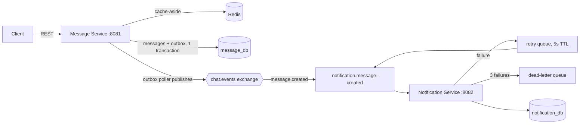

# Messaging System — Spring Boot Microservices

A chat backend with two microservices, Redis caching, RabbitMQ event queue and explicit concurrency control.

**Stack:** Java 17 · Spring Boot 3.3 · PostgreSQL 16 · Redis 7 · RabbitMQ 3 · Docker Compose

## Architecture



| Service | Responsibility | Owns |
|---|---|---|
| **message-service** | Conversations, message CRUD, ordering, caching, publishing events | `message_db`, Redis cache |
| **notification-service** | Consumes `message.created`, notifies every recipient, retry/DLQ | `notification_db`, its queues |

The services never call each other and never share a database. They communicate only through events.

## Run

```bash
docker compose up --build
./scripts/concurrency-test.sh        # needs curl + jq
```

- Message Service: http://localhost:8081
- Notification Service: http://localhost:8082
- RabbitMQ UI: http://localhost:15672 (app / app)

## API

Auth is out of scope. The caller is identified by the `X-User-Id` header (in production this would come from a JWT checked at the gateway).

```bash
# Create a conversation (creator is added automatically)
curl -X POST localhost:8081/conversations -H "X-User-Id: 1" -H "Content-Type: application/json" \
     -d '{"name":"team","memberIds":[2,3]}'

# Send a message (Idempotency-Key is optional; a retry with the same key won't duplicate)
curl -X POST localhost:8081/conversations/1/messages -H "X-User-Id: 1" \
     -H "Idempotency-Key: 7f3c..." -H "Content-Type: application/json" -d '{"content":"hi"}'

# Latest 50 messages (served from Redis when cached)
curl localhost:8081/conversations/1/messages -H "X-User-Id: 2"

# Older page
curl "localhost:8081/conversations/1/messages?beforeSeq=51&limit=50" -H "X-User-Id: 2"

# Edit (send the version you last saw; 409 if someone changed it first)
curl -X PATCH localhost:8081/messages/1 -H "X-User-Id: 1" -H "Content-Type: application/json" \
     -d '{"content":"hi (edited)","version":0}'

# Delete (soft delete)
curl -X DELETE localhost:8081/messages/1 -H "X-User-Id: 1"

# Notifications for a user
curl "localhost:8082/notifications?userId=2"
```

## Design decisions

### 1. Concurrency: message ordering (pessimistic lock)
Every message gets a per-conversation `seq`. On send we run
`UPDATE conversations SET last_seq = last_seq + 1 WHERE id = ? RETURNING last_seq`
inside the same transaction as the insert. The UPDATE takes a **row lock**, so concurrent senders to the same conversation are serialised, and the result is strictly ordered seq numbers with no gaps or duplicates. Different conversations lock different rows, so they don't block each other.

*Why not Redis `INCR`?* It is fast, but the counter and the insert would live in two systems. If the insert fails after `INCR`, you get a gap. If Redis loses data, the counter resets and you get duplicates. Keeping it in the DB transaction makes it atomic. The trade-off is that one very hot conversation is limited by row-lock throughput, and at that scale you would shard by conversation.

### 2. Concurrency: duplicate sends (idempotency)
Clients send an `Idempotency-Key`. A unique constraint on `(conversation_id, sender_id, idempotency_key)` plus `INSERT ... ON CONFLICT DO NOTHING` guarantees one row even when retries arrive at the same time. The losing transaction rolls back, which also releases the seq it reserved.

### 3. Concurrency: edits (optimistic lock)
Edits are rare, so we don't lock. Each row has a `version`. `UPDATE ... WHERE id = ? AND version = ?` affects 0 rows if someone else edited first, and the API returns **409 Conflict**.

### 4. Caching (cache-aside)
- Only the latest page of 50 is cached, because that's what every client loads when a chat opens.
- On write, the cache is **evicted after the transaction commits**. If we evicted before commit, a concurrent reader could re-cache the old data.
- A 5-minute TTL is a safety net for any missed eviction.
- **Redis down means reads go to Postgres.** All Redis errors are caught and timeouts are 500 ms, so a cache outage makes the app slower, not broken.

### 5. Reliable events (transactional outbox)
Saving to Postgres and publishing to RabbitMQ can't be committed atomically. So the event is written to an `outbox_events` table **in the same transaction** as the message. A scheduled poller publishes pending rows, waits for the broker's **publisher confirm**, then marks them published.
- `FOR UPDATE SKIP LOCKED` lets several instances poll at once without double-publishing.
- The guarantee is **at-least-once**: a crash between publish and mark can re-send.

### 6. Consumer: idempotency, retry, DLQ
- Unique `(message_id, recipient_id)` means a duplicate delivery can never create two notifications.
- On failure: retry queue with a 5 s TTL, which dead-letters back to the main queue. After 3 attempts the message goes to the **DLQ** for inspection. Bad JSON goes straight to the DLQ.
- To try it: `SIMULATE_FAILURE_RATE=0.7` on notification-service, then watch the queues in the RabbitMQ UI.

## Try the failure scenarios

```bash
docker compose stop redis      # reads still work (from Postgres), logs show fallback
docker compose stop rabbitmq   # sends still succeed; events wait in outbox_events
docker compose start rabbitmq  # pending events are published automatically
```

## Known limitations / next steps
- No auth (header-based user id).
- On the very first startup, if message-service publishes before notification-service has declared its queue, those events are unroutable. A fix would be to declare the queue from infra/IaC, or to use publisher returns with `mandatory`.
- No WebSocket push: clients poll. Next step would be a gateway with WebSockets fed by the same events.
- Outbox rows are never cleaned up, so a cleanup job would delete published rows older than N days.
"# Message-Queue-Simulator" 
